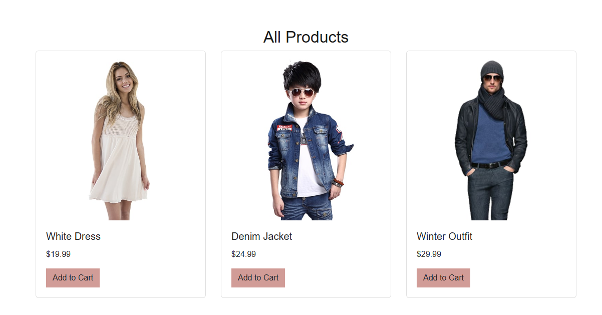
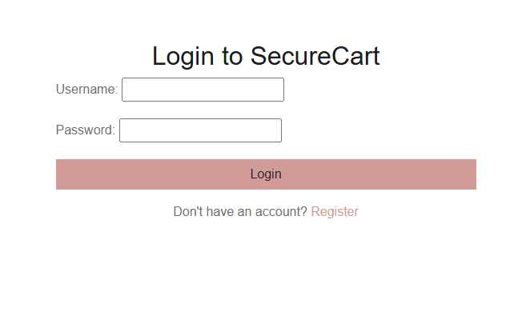
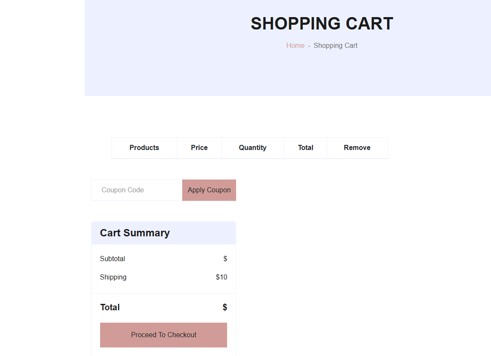
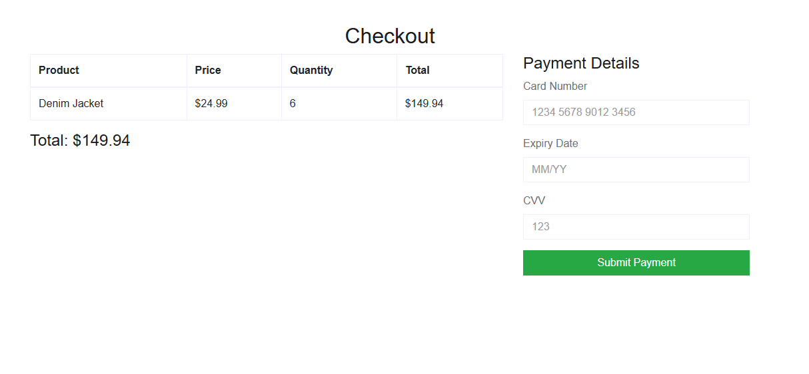
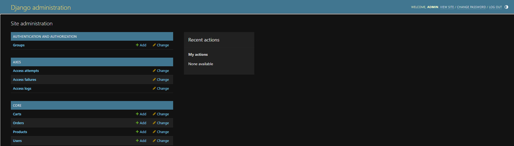

# SecureCart – Secure E-Commerce Web Application

## Overview

SecureCart is a prototype e-commerce web application built using the Django framework.

The project demonstrates how core online shopping functionality can be implemented while applying basic security practices such as authentication, access control, and server-side validation.

Users can browse products, manage a shopping cart, and complete transactions through a structured backend application.

---

## Features

- User authentication and session management
- Product catalogue browsing
- Shopping cart functionality
- Checkout workflow
- Role-based access control
- Admin dashboard for product and order management

---

## Technology Stack

Python  
Django  
PostgreSQL  
HTML Templates  
Bootstrap  

---

## Application Preview

### Product Catalogue



### Login Page



### Shopping Cart



### Checkout Process



### Admin Dashboard



---

## Project Structure

```
securecart-secure-ecommerce
│
├── manage.py
├── requirements.txt
├── .gitignore
│
├── securecart/              # Django project configuration
│   ├── settings.py
│   ├── urls.py
│   ├── asgi.py
│   └── wsgi.py
│
├── core/                    # Main application logic
│   ├── models.py
│   ├── views.py
│   ├── serializers.py
│   ├── permissions.py
│   ├── admin.py
│   ├── apps.py
│   ├── migrations/
│   ├── templates/
│   └── static/
│
├── screenshots/             # Application screenshots
└── README.md

---

## Running the Application

### 1 Install dependencies

```
pip install -r requirements.txt
```

### 2 Configure the database

Create a PostgreSQL database and a `.env` file next to `manage.py` with
`DB_NAME`, `DB_USER`, `DB_PASSWORD`, `DB_HOST`, `DB_PORT` and `SECRET_KEY`.

### 3 Apply database migrations

```
python manage.py migrate
```

### 4 Start the development server

```
python manage.py runserver
```

The application will be available at:

```
http://127.0.0.1:8000/
```

---

## Notes

I built this in my second year. The repository focuses on backend architecture and application logic rather than production deployment, and the interface is plain.

## Permission fix

`ProductViewSet` in `core/views.py` first set no `permission_classes`, so any
logged-in user could create, change or delete products through `/api/products/`.
It now sets `permission_classes = [IsAdminOrReadOnly]`. A customer gets a 403 on
create, update and delete, and an admin can still write. Side effect: the
product list can be read without a login. `core/test_product_permissions.py`
checks this; run it with `python manage.py test core.test_product_permissions`.
